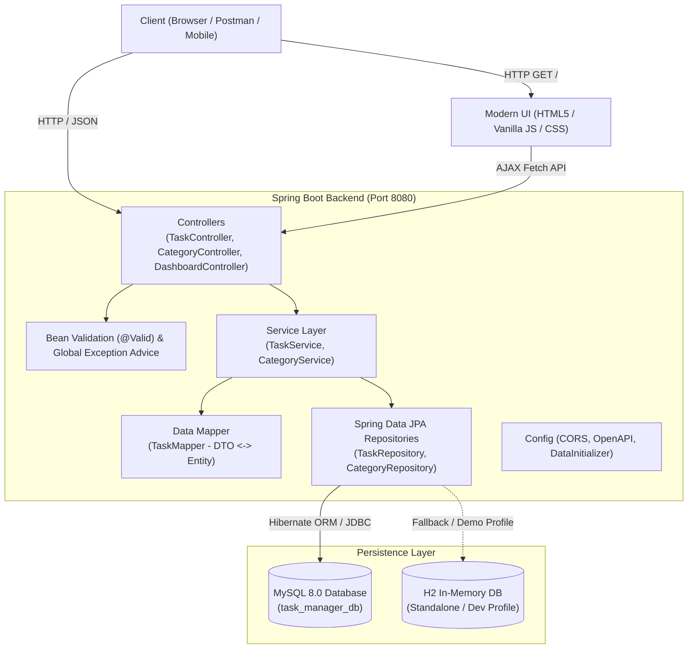

# ⚡ TaskPulse - Task Manager REST API & Interactive UI

[](https://openjdk.org/)
[](https://spring.io/projects/spring-boot)
[](https://hibernate.org/)
[](https://www.mysql.com/)
[](https://maven.apache.org/)
[](http://localhost:8080/swagger-ui.html)
[](https://www.postman.com/)

A production-grade **Task Management RESTful API** engineered with **Spring Boot 3, Spring MVC, Spring Data JPA, and MySQL**, accompanied by a handcrafted, human-designed modern SaaS web interface inspired by Linear and Raycast.

---

## 🌟 Key Features

- **Layered Enterprise Architecture**: Strict separation of concerns between Controller, Service, Repository, DTO, and Entity layers.
- **Full CRUD REST API**: Comprehensive endpoints for creating, reading, updating, patching, and deleting tasks and categories.
- **Dynamic Search, Filtering & Pagination**:
  - Filter by `status` (PENDING, IN_PROGRESS, COMPLETED, CANCELLED).
  - Filter by `priority` (LOW, MEDIUM, HIGH, URGENT).
  - Filter by `categoryId` and `overdueOnly`.
  - Full-text search across task titles and descriptions.
  - Configurable pagination (`page`, `size`) and sorting (`sortBy`, `sortDir`).
- **Data Validation & Robust Exception Handling**:
  - Jakarta Bean Validation (`@NotBlank`, `@Size`, `@NotNull`).
  - `@RestControllerAdvice` global exception handler producing standard error payloads with field-level validation maps.
- **Relational MySQL Persistence**:
  - Normalized schema with `tasks` and `categories` foreign key relationships (`ON DELETE SET NULL`).
  - Secondary indexes on `status`, `priority`, and `due_date` for query performance.
  - Connection pooling with HikariCP.
- **Handcrafted Modern Web UI**:
  - **Kanban Board View**: Visual columns (`To Do`, `In Progress`, `Completed`) with instant status transitions.
  - **Data Table View**: Clean tabular layout with inline completion checkboxes and quick actions.
  - **Live Analytics Cards**: Total tasks, in-progress count, completion rate progress bar, and overdue alert counter.
  - **Dark / Light Theme Engine**: Smooth CSS variable-based theme switcher persisted in `localStorage`.
  - **Keyboard Shortcuts**: Press <kbd>N</kbd> to compose a new task, <kbd>/</kbd> to jump to search, <kbd>Esc</kbd> to close modals.
- **Comprehensive Postman Collection**: Complete collection with environments, pre-request scripts, and automated assertion test suites.
- **Live Swagger OpenAPI 3**: Interactive API explorer at `/swagger-ui.html`.

---

## 📐 System Architecture



---

## 📂 Project Structure

```
task-manager-api/
├── pom.xml                                    # Maven configuration & dependencies
├── README.md                                  # Comprehensive documentation
├── .gitignore                                 # Git ignore rules for Java/IDE
├── database/
│   ├── schema.sql                             # MySQL DDL (tables, indexes, foreign keys)
│   └── data.sql                               # Seed data for MySQL
├── postman/
│   ├── TaskManager_API.postman_collection.json # 6 folders: CRUD, Filters, Status, Categories, Stats, Errors
│   └── TaskManager_Environment.postman_environment.json # Base URL and dynamic IDs
└── src/
    ├── main/
    │   ├── java/com/taskmanager/
    │   │   ├── TaskManagerApplication.java    # Spring Boot Main Entry Point
    │   │   ├── config/
    │   │   │   ├── OpenApiConfig.java         # Swagger UI 3 configuration
    │   │   │   ├── CorsConfig.java            # CORS cross-origin configuration
    │   │   │   └── DataInitializer.java       # Automatic seed data runner on startup
    │   │   ├── controller/
    │   │   │   ├── TaskController.java        # /api/v1/tasks endpoints
    │   │   │   ├── CategoryController.java    # /api/v1/categories endpoints
    │   │   │   └── DashboardController.java   # /api/v1/dashboard metrics & health
    │   │   ├── dto/
    │   │   │   ├── TaskRequest.java           # Create/Update task validation DTO
    │   │   │   ├── TaskResponse.java          # Clean task output DTO with overdue calculation
    │   │   │   ├── TaskStatusUpdateDto.java   # Patch status DTO
    │   │   │   ├── CategoryDto.java           # Category view DTO
    │   │   │   ├── CategoryRequest.java       # Category creation DTO
    │   │   │   ├── DashboardStatsDto.java     # Aggregated analytics DTO
    │   │   │   ├── ApiResponse.java           # Standard envelope {success, message, data, timestamp}
    │   │   │   ├── PageResponse.java          # Paginated envelope {content, page, size, totalElements}
    │   │   │   └── ErrorResponse.java         # Standard error format with validation maps
    │   │   ├── entity/
    │   │   │   ├── Task.java                  # JPA Entity mapped to 'tasks' table
    │   │   │   ├── Category.java              # JPA Entity mapped to 'categories' table
    │   │   │   ├── Priority.java              # Enum: LOW, MEDIUM, HIGH, URGENT
    │   │   │   └── TaskStatus.java            # Enum: PENDING, IN_PROGRESS, COMPLETED, CANCELLED
    │   │   ├── exception/
    │   │   │   ├── ResourceNotFoundException.java # HTTP 404
    │   │   │   ├── BadRequestException.java       # HTTP 400
    │   │   │   ├── DuplicateResourceException.java # HTTP 409
    │   │   │   └── GlobalExceptionHandler.java    # RestControllerAdvice
    │   │   ├── mapper/
    │   │   │   └── TaskMapper.java            # Clean Entity <-> DTO translation
    │   │   ├── repository/
    │   │   │   ├── TaskRepository.java        # JpaRepository with JPQL multi-filter & counts
    │   │   │   └── CategoryRepository.java    # JpaRepository for categories
    │   │   └── service/
    │   │       ├── TaskService.java           # Task business logic contract
    │   │       ├── CategoryService.java       # Category business logic contract
    │   │       └── impl/
    │   │           ├── TaskServiceImpl.java   # Transactional service implementation
    │   │           └── CategoryServiceImpl.java
    │   └── resources/
    │       ├── application.properties         # Default configuration (MySQL datasource)
    │       ├── application-mysql.properties   # Production MySQL profile
    │       ├── application-h2.properties      # Zero-config in-memory profile
    │       └── static/                        # Handcrafted Modern Web UI
    │           ├── index.html                 # Main Dashboard HTML5 application
    │           ├── css/styles.css             # Polished CSS design system
    │           └── js/app.js                  # Modular client app
    └── test/
        ├── java/com/taskmanager/
        │   ├── TaskManagerApplicationTests.java
        │   ├── controller/TaskControllerTest.java # MockMvc endpoint verification
        │   └── service/TaskServiceTest.java       # Mockito unit tests
        └── resources/
            └── application.properties         # Test DB configuration
```

---

## 🗄️ Database Setup (MySQL 8)

### Option 1: Automatic Table Creation via JPA
By default, `application.properties` connects to MySQL at `localhost:3306` with database `task_manager_db` and uses `spring.jpa.hibernate.ddl-auto=update`, which creates or updates the tables automatically.

### Option 2: Execute SQL DDL Script
Open **MySQL Workbench**, **DBeaver**, or the **MySQL CLI** and run:

```bash
mysql -u root -p < database/schema.sql
mysql -u root -p < database/data.sql
```

The database schema includes:
```sql
CREATE TABLE IF NOT EXISTS `categories` (
    `id` BIGINT AUTO_INCREMENT PRIMARY KEY,
    `name` VARCHAR(60) NOT NULL UNIQUE,
    `color` VARCHAR(20) DEFAULT '#3B82F6',
    `description` VARCHAR(255) NULL,
    `created_at` DATETIME NOT NULL DEFAULT CURRENT_TIMESTAMP
);

CREATE TABLE IF NOT EXISTS `tasks` (
    `id` BIGINT AUTO_INCREMENT PRIMARY KEY,
    `title` VARCHAR(150) NOT NULL,
    `description` TEXT NULL,
    `status` VARCHAR(20) NOT NULL DEFAULT 'PENDING',
    `priority` VARCHAR(20) NOT NULL DEFAULT 'MEDIUM',
    `due_date` DATE NULL,
    `category_id` BIGINT NULL,
    `created_at` DATETIME NOT NULL DEFAULT CURRENT_TIMESTAMP,
    `updated_at` DATETIME NULL ON UPDATE CURRENT_TIMESTAMP,
    CONSTRAINT `fk_tasks_category` FOREIGN KEY (`category_id`) REFERENCES `categories` (`id`) ON DELETE SET NULL,
    INDEX `idx_task_status` (`status`),
    INDEX `idx_task_priority` (`priority`),
    INDEX `idx_task_due_date` (`due_date`)
);
```

---

## 🚀 How to Run

### Prerequisites
- **JDK 21** installed (`java -version`)
- **Maven 3.8+** installed (`mvn -v`)
- **MySQL 8.0+** running locally on port 3306

### Running with MySQL (Default)
```bash
# 1. Clone or navigate to the repository
cd task-manager-api

# 2. Run the application
mvn spring-boot:run
```
*(Or specify custom credentials via environment variables: `SPRING_DATASOURCE_USERNAME=myuser SPRING_DATASOURCE_PASSWORD=mypass mvn spring-boot:run`)*

### Running with In-Memory H2 (Instant Standalone Demo)
If MySQL is not currently running and you want an instant zero-setup trial:
```bash
mvn spring-boot:run -Dspring-boot.run.profiles=h2
```
or run the pre-built JAR:
```bash
java -jar target/task-manager-api-1.0.0.jar --spring.profiles.active=h2
```

### Accessing the Application
- **Interactive Web UI**: [http://localhost:8080/](http://localhost:8080/)
- **Swagger OpenAPI Explorer**: [http://localhost:8080/swagger-ui.html](http://localhost:8080/swagger-ui.html)
- **OpenAPI JSON Spec**: [http://localhost:8080/v3/api-docs](http://localhost:8080/v3/api-docs)
- **H2 Console** *(when H2 profile active)*: [http://localhost:8080/h2-console](http://localhost:8080/h2-console)

---

## 📡 REST API Reference

All responses follow the unified envelope:
```json
{
  "success": true,
  "message": "Operation successful",
  "data": { ... },
  "timestamp": "2026-11-18T12:00:00"
}
```

### Task Endpoints (`/api/v1/tasks`)

| Method | Endpoint | Description | Query Parameters / Body |
| :--- | :--- | :--- | :--- |
| `GET` | `/api/v1/tasks` | Get paginated & filtered tasks | `status`, `priority`, `categoryId`, `search`, `overdueOnly`, `page`, `size`, `sortBy`, `sortDir` |
| `GET` | `/api/v1/tasks/{id}` | Get single task by ID | - |
| `POST` | `/api/v1/tasks` | Create a new task | `{ "title": "...", "description": "...", "priority": "HIGH", "dueDate": "2026-12-01", "categoryId": 1 }` |
| `PUT` | `/api/v1/tasks/{id}` | Update existing task | Full task request payload |
| `PATCH` | `/api/v1/tasks/{id}/status` | Quick status transition | `{ "status": "COMPLETED" }` |
| `DELETE` | `/api/v1/tasks/{id}` | Delete task by ID | - |
| `GET` | `/api/v1/tasks/stats` | Aggregate dashboard statistics | Total, counts by status/priority, completion rate % |

### Category Endpoints (`/api/v1/categories`)

| Method | Endpoint | Description | Query Parameters / Body |
| :--- | :--- | :--- | :--- |
| `GET` | `/api/v1/categories` | List all categories with task counts | - |
| `GET` | `/api/v1/categories/{id}` | Get category by ID | - |
| `POST` | `/api/v1/categories` | Create new category | `{ "name": "DevOps", "color": "#F59E0B", "description": "Cloud & CI/CD" }` |
| `DELETE`| `/api/v1/categories/{id}` | Delete category | - |

### System & Health (`/api/v1/dashboard`)

| Method | Endpoint | Description |
| :--- | :--- | :--- |
| `GET` | `/api/v1/dashboard/health` | Health check endpoint returning service status, timestamp, and version |
| `GET` | `/api/v1/dashboard/stats` | High-level metrics for dashboard graphs |

---

## 📮 Postman Collection & Automated Testing

The repository contains a complete, automated test suite:
- `postman/TaskManager_API.postman_collection.json`
- `postman/TaskManager_Environment.postman_environment.json`

### How to Import & Run in Postman:
1. Open **Postman**.
2. Click **Import** (top left).
3. Drag & drop both JSON files from the `postman/` folder.
4. Select the environment: **"Task Manager - Local Environment"** in the top-right environment selector.
5. Click on the collection name and choose **"Run collection"**.
6. All automated assertions (status code checks, schema validation, response time, and dynamic variable propagation) will execute.

---

## 🧪 Running Unit & Integration Tests

```bash
# Run tests using Maven
mvn test
```

The test suite covers:
- **`TaskServiceTest`**: Unit tests verifying business logic, edge cases, not-found exception throwing, and dashboard statistic calculations.
- **`TaskControllerTest`**: MockMvc integration tests verifying HTTP status codes, JSON response formatting, Bean Validation constraints, and error mappings.

---

## 📄 License
This project is licensed under the [MIT License](https://opensource.org/licenses/MIT).
